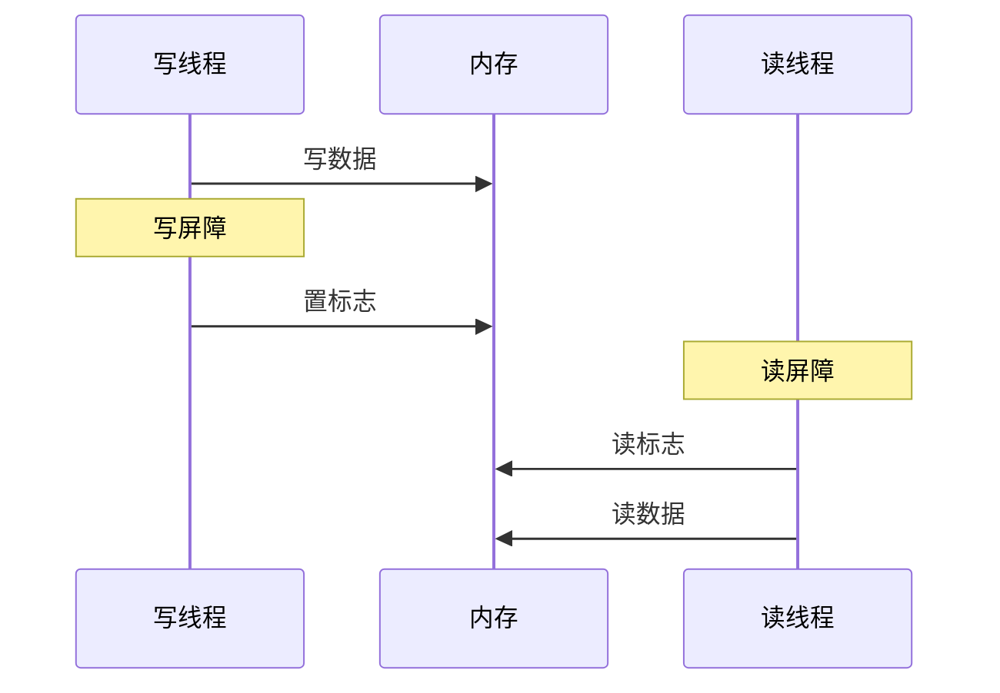

# 样例

## 1. 文首骨架：丢掉定义式开头

原来的写法是 `__threadfence() establishes device-scope ordering...`。
精炼后的骨架：

> 这件事里总共三块：① 一个线程写，② 另一个线程读，③ 把前两件事排上序的那个东西。
>
> 写的时候先把数据放进内存，读的时候从内存里拿；③ 决定了读出来的到底是旧数据还是新数据。在这三块之外，经常有一个东西被混进来——让线程停下来互相等待。那是另一件事，正文不碰它。
>
> | 概念 | 一句话 |
> | --- | --- |
> | 写 / 读 | 一个线程把值放进内存 / 另一个线程把值取出来 |
> | 排序 | 让一组内存操作的先后顺序对别人成立 |
> | 屏障 | 让线程之间互相停下来等彼此 |
>
> 展开从 ③ 开始，顺带说清它和屏障怎么分；① 和 ② 作为背景放在后面。
>
> 若读者平时就说 fence / barrier，上表直接用这两个词，不再另造“排序 / 屏障”。

---

## 2. 分块小节：代号延后

骨架只给概念表：

> 一次查询的链路分五块：① 请求、② 缓存、③ 向量库、④ 重排、⑤ 结果集。
>
> 顺序是：请求 → 缓存 →（没命中）向量库 → 重排 → 结果集。

讲“重排”这一节时，绝不出任何类名：

> **重排**
>
> 向量库给的候选又快又粗；重排用更贵的算法把这几十条重新排序。它只处理这几十条，成本压得住。
>
> 它存在是因为便宜的那一步必须一次捞出很多条才能保证召回，而捞出来的这堆东西顺序不可信。
>
> 向量库交出一批粗筛候选，重排交回同样数量但顺序洗过的新候选，最后取前几条。
>
> 这块闭合了。下一块讲缓存为什么绕不过这一步。

代号留给文末的对照表：

> 代码里它们长这样：
>
> | 概念 | 代号 |
> | --- | --- |
> | 缓存 | `EmbeddingCache.get` |
> | 向量库 | `VectorStore.query` |
> | 重排 | `Reranker.rank` |
> | 结果集 | `SearchResult[]` |
>
> 概念版连起来说，叙述里不该出现代号。反面写法长这样：
>
> `EmbeddingCache.get()` 没命中就去调 `VectorStore.query()`，再经 `Reranker.rank()` 返回 `SearchResult[]`。

---

## 3. 长文档的骨架

> 这篇论文其实只在解决一件事：缓存把网络传输量砍了一半多，为什么端到端延迟几乎没动。
>
> 全文拆成四块：① 现象、② 归因、③ 机制、④ 证据。建议按 ① → ③ → ② → ④ 读：先看现象，再看他们提出的机制，然后才看得懂归因；证据留到最后评。
>
> | 概念 | 一句话 |
> | --- | --- |
> | 传输量 | 一次查询在网络上搬了多少字节 |
> | 关键路径 | 一次查询里必须串着等完的那几段 |
> | 命中率 | 请求里不用回源的比例 |
>
> ① 里有一个数字值得先记住：传输量掉了 55%，延迟只掉了 4.9%。
> 正文从 ① 开始，那里正好解释这两个数为什么能同时成立。

---

## 4. 术语卡片与反直觉数字

> **HOL 阻塞**
>
> 先进先出队列里，队头塞了一件大货，把后面的急件全堵住了。
>
> 为什么成问题：批量数据和控制消息共用一条队列，分不清谁急。
>
> 容易和什么混：拥塞和丢包。网络完全空闲时它照样发生。

卡片讲完立刻落到实例上：

> 缓存把走上网络的向量数砍了 55%，但查询延迟只降了 4.9%。
>
> 先别怀疑测量。延迟由最慢的那条腿决定。少掉 55% 的向量，剩下的 45% 照样要过网络、照样在终点被串行等着。
>
> 量是动了，但关键路径没动。

---

## 5. 概念密集处用图

这些角色（写线程、读线程、内存、两个屏障）的关系，文字版要逐句复原：

> 写线程先写数据，过写屏障之后才置标志；读线程过读屏障，再读标志、读数据；缓存插在中间时，读线程可能看到新标志却读到旧数据，两个屏障合起来堵住这条缝。

同样的内容一张时序图一眼可查。先交代读法（“箭头是内存操作，Note 标出屏障生效的位置”），再落图：

泳道名沿用概念表短名，代号不进图。
